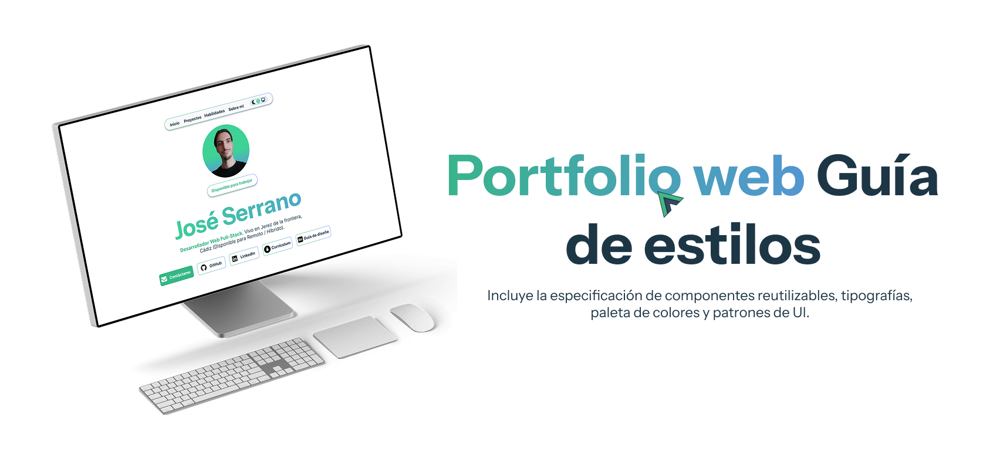

# Portfolio Web - José Serrano Salguero 

Bienvenido al repositorio de mi portfolio personal. Este proyecto reúne mis trabajos destacados como **Desarrollador Web Full-Stack**, mi formación técnica y mi evolución profesional.

**Preview:** [Ver Portfolio Desplegado](https://portfolio-two-eta-s0xf3i7ryc.vercel.app/)  
**Guía de estilos:** [Ver guía de estilos](https://www.behance.net/gallery/256949487/Portfolio-web-Guia-de-estilos/modules/1500391247)  

---

## Stack Tecnológico y Herramientas
* **Frontend:** Vue.js, Tailwind CSS, HTML5.
* **Diseño UI/UX:** Figma (Prototipado y Guía de Estilos propia).
* **Arquitectura y Planificación:** Diagramas estructurales y control de versiones con Git/GitHub.
* **Despliegue:** Vercel.
